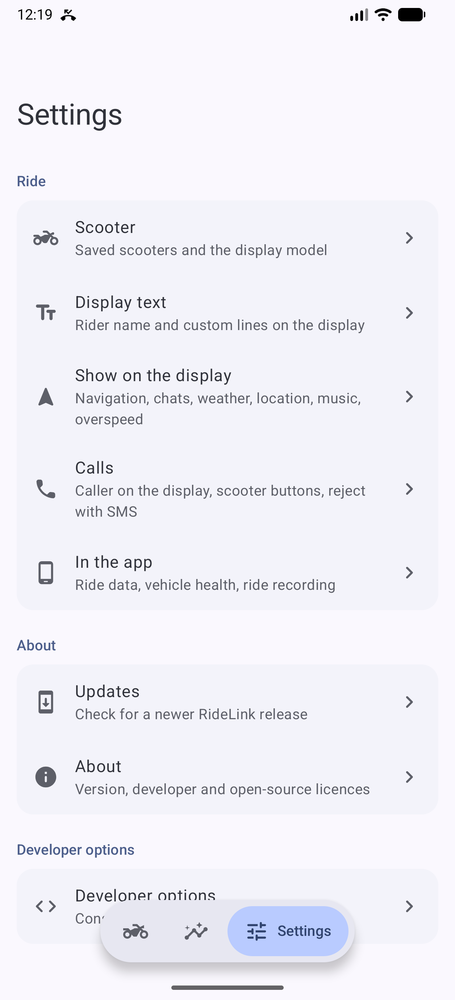
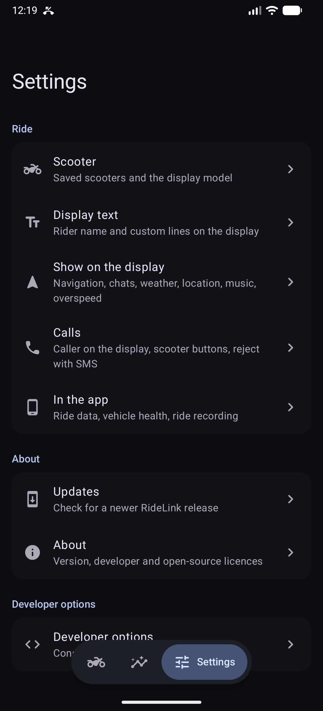
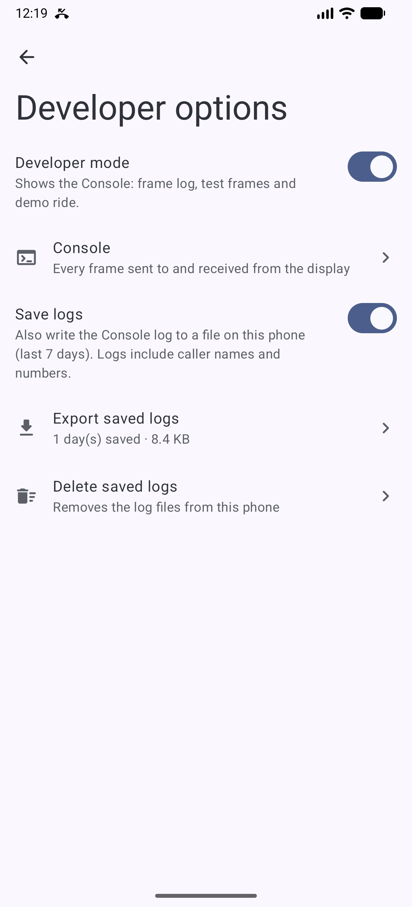
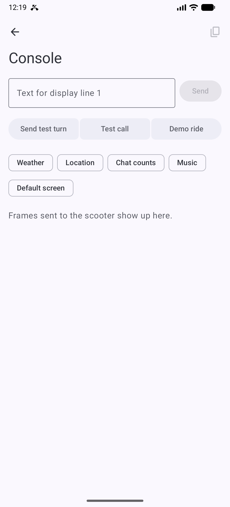
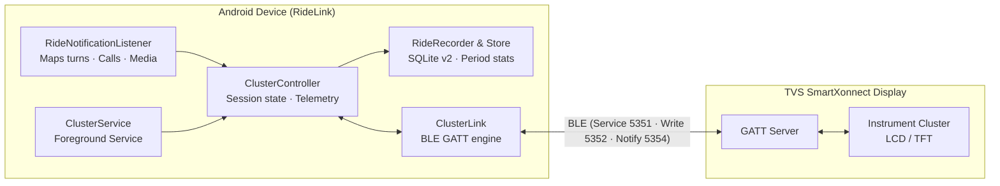
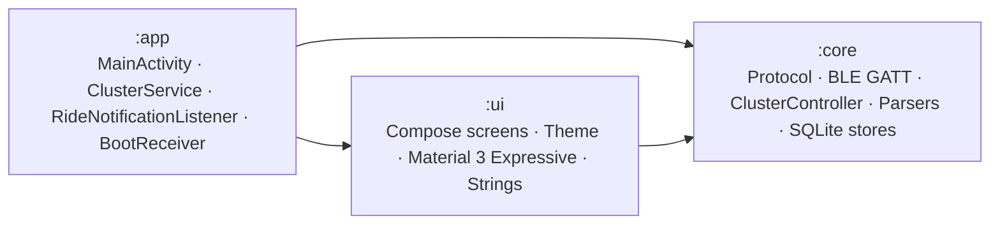

<p align="center">
  
</p>

# RideLink

<p align="center">
  <b>Your scooter display, without the account.</b><br>
  A private, local-first Android companion app for TVS SmartXonnect scooter displays.
</p>

<p align="center">
  <a href="https://github.com/aiyu-ayaan/RideLink/actions/workflows/release.yml"></a>
  <a href="https://github.com/aiyu-ayaan/RideLink/releases"></a>
  <a href="https://github.com/aiyu-ayaan/RideLink/commits/master"></a>
  
  
  
  
</p>

---

RideLink connects your phone to your TVS SmartXonnect scooter display over Bluetooth Low Energy (BLE). It replaces the official TVS Connect app for riding features: it streams Google Maps turn-by-turn directions, forwards caller ID and accepts/rejects calls with handlebar buttons, syncs media info, and keeps time, battery, signal, and local weather up to date.

**Zero accounts. Zero cloud servers. Zero tracking.** All communications stay between your phone and your scooter.

## Highlights

- **Turn-by-turn navigation**: Reads Google Maps notifications live and maps navigation icons directly to scooter dashboard arrows and distance readouts.
- **Call control**: Shows caller ID on incoming calls; answer or reject calls using scooter switches or quick auto-SMS templates.
- **Media sessions**: Syncs track title, artist, playback state, and volume to compatible digital displays.
- **Live telemetry & status**: Real-time speed, trip meters, odometer, fuel level, range, engine temperatures, service reminders, and MIL diagnostics.
- **Ride analytics & history**: Automatic ride recording with split distance sourcing (Google Maps route progress vs. odometer vs. speed integration), elevation, speed bands, and SQLite history exportable to CSV.
- **Weather & environment**: Optional local temperature, AQI, and location sync via Open-Meteo (no API key required).
- **Multi-scooter garage**: Pair and manage multiple scooters with per-bike model profiles and auto-reconnect.
- **Material 3 Expressive UI**: Built entirely in Jetpack Compose with dynamic color, adaptive layouts, dark/light themes, and floating pill navigation.
- **In-app updates**: Built-in GitHub Releases updater supporting Stable, Beta, and Alpha release channels.

## Supported scooters

RideLink works with TVS Bluetooth-equipped SmartXonnect clusters:

| Model | Display type | Features supported |
|---|---|---|
| **NTORQ 125 (Disc / Race Edition)** | Segment LCD | Navigation arrows, distance, caller ID, missed calls, battery, signal, clock |
| **NTORQ Race XP** | Segment LCD (Dual Mode) | Navigation, caller ID, high-speed alerts, ride modes, telemetry |
| **NTORQ XT** | Hybrid TFT + LCD | Navigation, caller ID, full weather & AQI, social notifications, music info, custom display text lines |
| **2025+ SmartXonnect Models** | Modern digital clusters | Auto model detection via protocol handshake |

## Screenshots

| Ride (Light) | Ride (Dark) | Settings | Developer Console |
|:---:|:---:|:---:|:---:|
|  |  |  |  |
| Real-time connection, navigation turn & vehicle stats | Dark theme with dynamic color support | Modular settings sections and scooter garage | Live BLE frame log & diagnostic test injection |

## How it works



### Data flow

1. **Connection**: Scans for BLE advertisements matching TVS displays. Once paired, `ClusterService` maintains a persistent foreground GATT link with automatic reconnection.
2. **Handshake**: Negotiates MTU 512, enables notifications on `5354`, authenticates rider profile (`5B 52`), and syncs media state and social counts.
3. **Heartbeat & Telemetry**: Emits status packets (`5B 4A`) every 2 seconds with time, battery percentage, signal strength, network status, and ambient temperature. Incoming notify frames (`5A 10`, `5A 11`, `5A 19`) update local speed, trip distance, fuel, range, and diagnostic telemetry.
4. **Navigation**: Intercepts Google Maps active navigation steps, converts direction arrows and distance meters into cluster-native control codes (`5B 4F` text + `5A 4E` instruction), and streams them with synchronized timing.
5. **Calls**: Injects ringing caller frames (`5B 43`) every 500 ms; handles cluster switch presses to answer or reject calls through Android's `TelecomManager`.

Full protocol reverse-engineering notes and frame structures are documented in [`PROTOCOL.md`](PROTOCOL.md).

## Architecture

RideLink is organized into three clean Gradle modules:



- **`:app`**: Application entry point, Android manifest, foreground services, broadcast receivers, and application lifecycle.
- **`:core`**: Protocol encoders/decoders, BLE GATT link manager, notification parsers, telecom integration, weather repository, and SQLite databases (`garage.db`, `rides.db`).
- **`:ui`**: 100% Jetpack Compose UI, Material 3 Expressive theming, navigation graphs, canvas analytics charts, and localized strings.

For deep dive into state ownership and lifecycle, see [`development/docs/ARCHITECTURE.md`](development/docs/ARCHITECTURE.md).

## Installation

### Releases

Download the latest signed release APK from the [Releases](https://github.com/aiyu-ayaan/RideLink/releases) page.

RideLink features an in-app updater (**Settings → About → Updates**). Once installed, updates can be checked, downloaded, and installed directly with support for **Stable**, **Beta**, and **Alpha** channels.

### Permissions explained

RideLink requests only the permissions needed to replicate dashboard functionality:

| Permission | Purpose |
|---|---|
| **Nearby devices / Bluetooth** | Connect to the scooter cluster over BLE. |
| **Notification access** | Read Google Maps navigation steps and incoming caller details. |
| **Phone state & call log** *(Optional)* | Display caller names and signal bar status on the speedometer. |
| **Answer phone calls** *(Optional)* | Accept incoming calls using the scooter's handlebar switch. |
| **Location (Coarse)** *(Optional)* | Fetch local weather and air quality via Open-Meteo for TFT clusters. |

## Development & build

### Prerequisites

- Android Studio Ladybug / Meerkat or newer
- JDK 17 or 21
- Android SDK 35 (Android 15)

### Build commands

```bash
# Clone the repository
git clone https://github.com/aiyu-ayaan/RideLink.git
cd RideLink

# Assemble debug APK
./gradlew assembleDebug

# Run unit tests
./gradlew test

# Run protocol verification tests
./gradlew :core:test --tests "com.aiyu.ridelink.core.protocol.*"
```

The debug APK will be placed at `app/build/outputs/apk/debug/app-debug.apk`.

### Test tools (`tools/`)

The repository includes desktop Python test utilities (requires BlueZ on Linux, `python3-dbus`, and `python3-gi`):

- **`tools/fake_cluster.py`**: Emulates a TVS SmartXonnect scooter display over BlueZ GATT, printing decoded frames received from the phone.
- **`tools/central_test.py`**: Simulates the phone central and injects pinned test frames into a real or virtual display.

## Privacy & ethics

- **No telematics sent to third parties**: RideLink contains zero analytics SDKs, trackers, or telemetry endpoints.
- **Personal use project**: RideLink is an independent open-source project and is not affiliated with, endorsed by, or connected to TVS Motor Company. No proprietary TVS code or assets are distributed.

## Related docs

- [`PROTOCOL.md`](PROTOCOL.md) — Specification of TVS SmartXonnect BLE frames and opcodes
- [`development/docs/ARCHITECTURE.md`](development/docs/ARCHITECTURE.md) — Subsystem architecture and data flow
- [`development/docs/DESIGN_SYSTEM.md`](development/docs/DESIGN_SYSTEM.md) — Visual styling, tokens, and motion curves
- [`development/brand/BRAND.md`](development/brand/BRAND.md) — Brand identity, geometry, and asset guidelines
- [`CHANGELOG.md`](CHANGELOG.md) — Version history and release notes
