<p align="center">
  
</p>

# RideLink

<p align="center">
  <b>Your scooter display, without the account.</b><br>
  A private, local-first Android companion app for TVS SmartXonnect scooter displays.
</p>

<p align="center">
  <a href="https://github.com/aiyu-ayaan/RideLink/releases/latest/download/RideLink.apk"></a>
</p>

<p align="center">
  <a href="https://github.com/aiyu-ayaan/RideLink/actions/workflows/release.yml"></a>
  <a href="https://github.com/aiyu-ayaan/RideLink/releases"></a>
  <a href="https://github.com/aiyu-ayaan/RideLink/commits/master"></a>
  
  
  
  
</p>

---

RideLink connects your phone to your TVS SmartXonnect scooter display over Bluetooth Low Energy (BLE). It replaces the official TVS Connect app for riding features: it streams Google Maps turn-by-turn directions, forwards caller ID and accepts/rejects calls with handlebar buttons, syncs media info, and keeps time, battery, signal, and local weather up to date.

**No TVS account, no TVS servers.** Riding features run between your phone and your scooter. A Google account is optional and only used for your own cloud backup.

## Highlights

- **Turn-by-turn navigation**: Reads Google Maps notifications live and maps navigation icons directly to scooter dashboard arrows and distance readouts.
- **Call control**: Shows caller ID on incoming calls; answer or reject calls using scooter switches or quick auto-SMS templates.
- **Media sessions**: Syncs track title, artist, playback state, and volume to compatible digital displays.
- **Live telemetry & status**: Real-time speed, trip meters, odometer, fuel level, range, engine temperatures, service reminders, and MIL diagnostics.
- **Ride analytics & history**: Automatic ride recording with split distance sourcing (Google Maps route progress vs. odometer vs. speed integration), elevation, speed bands, and SQLite history exportable to CSV.
- **Weather & environment**: Optional local temperature, AQI, and location sync via Open-Meteo (no API key required).
- **Fuel and service**: Fuel log with real full-to-full mileage and cost per km (₹), automatic refuel detection from the fuel gauge, low-fuel alert that finds a petrol pump in Maps, and service / insurance / PUC reminders shown on the display.
- **Riding safety**: WhatsApp auto-reply while riding (one-to-one chats, once per ride), ride check-in SMS with a Google Maps link at start and end, and a precise last-parked spot.
- **Cloud backup (optional)**: Sign in with Google to back up rides, fuel log, care records, scooters and settings to Firestore, WhatsApp style: daily, weekly, monthly or only when you tap *Back up now*, in the background via WorkManager. A new phone gets a restore offer; when two phones disagree you choose *Merge both*, *Use cloud backup* or *Keep this phone's data*.
- **Multi-scooter garage**: Pair and manage multiple scooters with per-bike model profiles and auto-reconnect.
- **Material 3 Expressive UI**: Built entirely in Jetpack Compose with dynamic color, adaptive layouts, dark/light themes, and floating pill navigation.
- **22 Indian languages + English**: In-app language picker (**Settings → In-App → Language**) supporting System default, English, and all 22 Scheduled Indian Languages (Hindi, Bengali, Telugu, Marathi, Tamil, Urdu, Gujarati, Kannada, Malayalam, Odia, Punjabi, Assamese, Kashmiri, Nepali, Sindhi, Sanskrit, Maithili, Santali, Konkani, Dogri, Manipuri, and Bodo).
- **Auto model detection**: Recognises the SmartXonnect LCD (Race XP), older Ntorq and 2025+ clusters from their own frames.
- **Race XP extras**: Race stats, display brightness, SMS sender, birthday greeting, last parked location and missed-call auto-reply.
- **Developer tools**: Demo navigation through every turn type, arrow and alert code sweeps, and a live frame console.
- **In-app updates**: Built-in GitHub Releases updater supporting Stable, Beta, and Alpha release channels.

## Supported scooters

RideLink detects the display from the frames it sends and picks the right protocol by itself (Settings → Scooter → Auto). You can also pick the model by hand.

| Scooter | Years | Display | Protocol in RideLink | Turn-by-turn | Status |
|---|---|---|---|---|---|
| **NTORQ 125 Race XP** | 2020 – 2026 | SmartXonnect LCD, arrow pictogram + 2 text lines | SmartXonnect (auto-detected) | Arrow + distance + direction words | ✅ Tested on a 2026 Race XP |
| **NTORQ 125** Standard / Race Edition / Super Squad / Marvel editions | 2018 – 2024 | SmartXonnect LCD | SmartXonnect (auto-detected) | Arrow + distance + direction words | 🟡 Same protocol as the Race XP, not yet tested |
| **NTORQ 125 XT** | 2023+ | Hybrid TFT + LCD | Older Ntorq (U577 premium) | Arrow + distance | 🟡 Untested on a real scooter |
| **NTORQ 125** (U716) / U577 base | 2022 – 2024 | LCD | Older Ntorq | Arrow + distance | 🟡 Untested |
| **NTORQ 125** 2025+ (U812, N251 Standard, U458 Race, U377 Super Squad) | 2025+ | Digital cluster | 2025+ Ntorq | Arrow + distance + text | 🟡 Built from the TVS app, untested |
| **NTORQ 150** | 2025+ | TFT / LCD | Not supported yet | – | ❌ |

What works on every supported display: Google Maps turn-by-turn, caller ID with accept/reject from the scooter switch, missed calls, phone battery, signal, clock sync, WhatsApp/Facebook/Instagram counts, rider name and custom text lines, overspeed alert, live ride data and ride analytics.

Extras on the SmartXonnect LCD (Race XP): race stats (best lap, top speed, 0–60), display brightness, SMS sender, birthday / purchase-day greeting, plus experimental notification-light clear, food delivery alerts and last-ride CO2.

Extras on TFT displays: weather + AQI, place name and music info.

Tested your scooter? Use the [vehicle report form](https://github.com/aiyu-ayaan/RideLink/issues/new?template=vehicle_report.yml) with the model and year and a Console log (Settings → Developer options → Save logs) so it can move to ✅.

Other TVS vehicles (Raider, Apache, Ronin, Jupiter, iQube and more) are not supported yet. See [vehicle support](docs/VEHICLE_SUPPORT.md).

## Screenshots

| Ride (Demo Mode) | Ride (Dark Theme) | Analytics | Fuel & Service | Garage & Model |
|:---:|:---:|:---:|:---:|:---:|
| 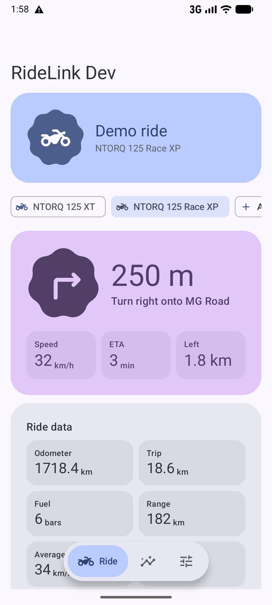 | 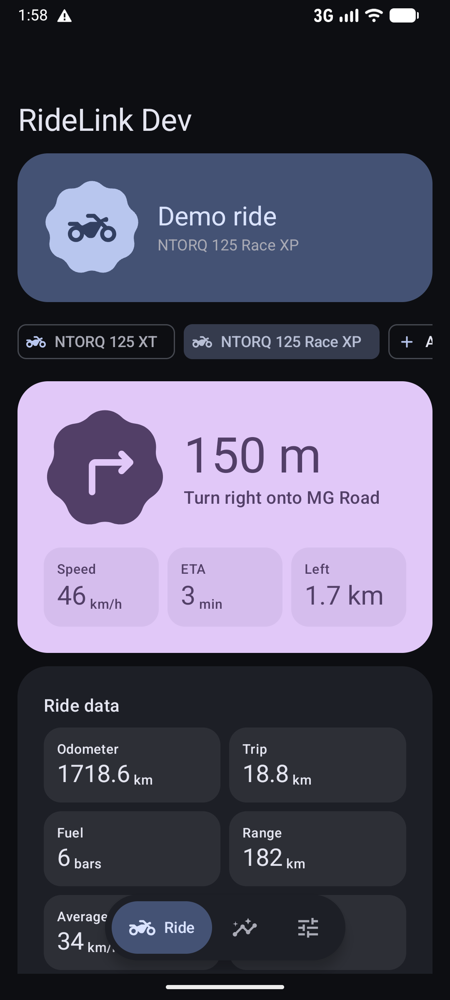 | 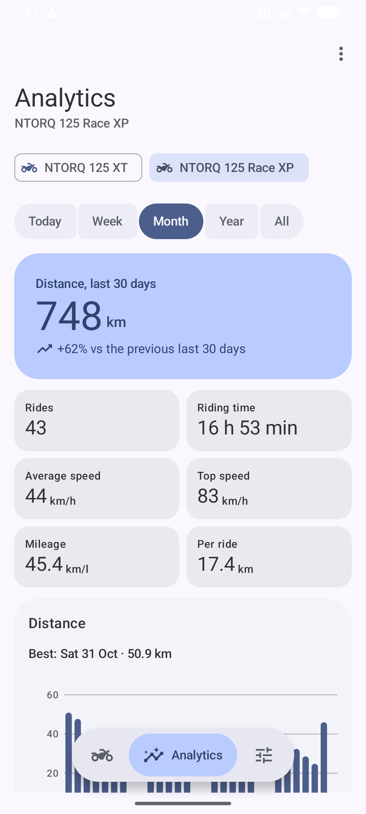 | 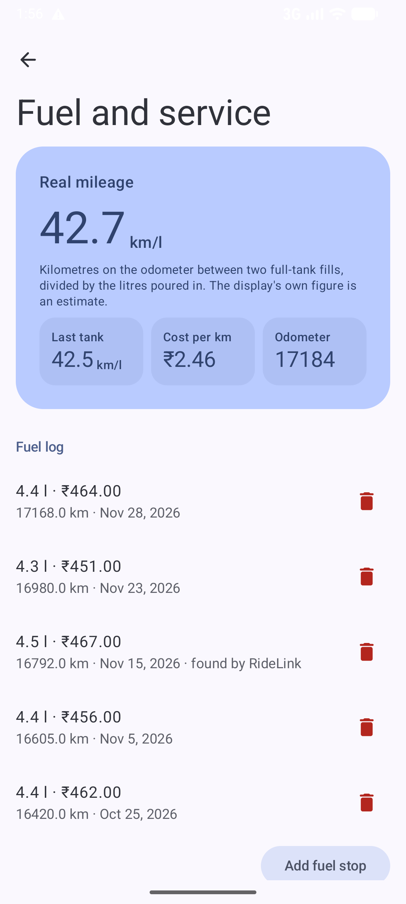 | 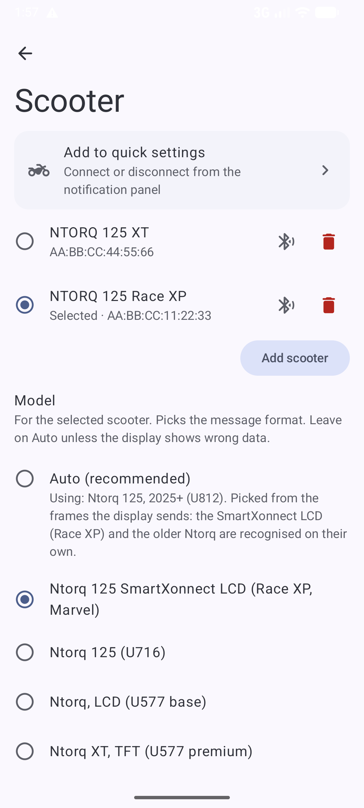 |
| Active navigation turn, speed & live telemetry | Material 3 dark theme with scooter chips | Period stats, distance chart & ride records | Full-to-full mileage, ₹/km & fuel log | Multi-scooter garage & cluster model picker |

| Welcome & Sign-in | Cloud Backup | Settings | 23 Languages | Developer Console |
|:---:|:---:|:---:|:---:|:---:|
| 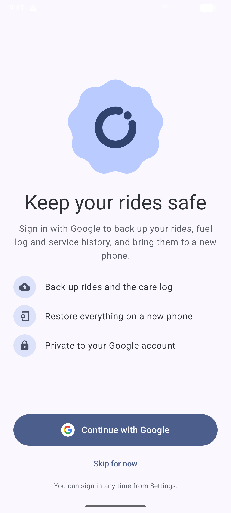 | 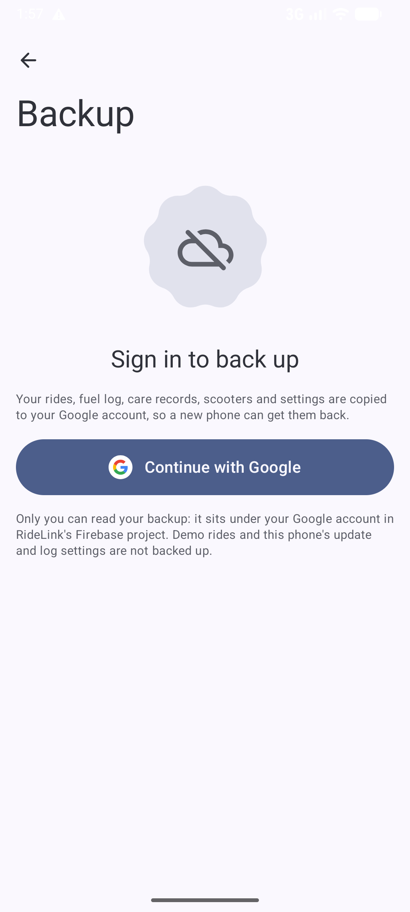 | 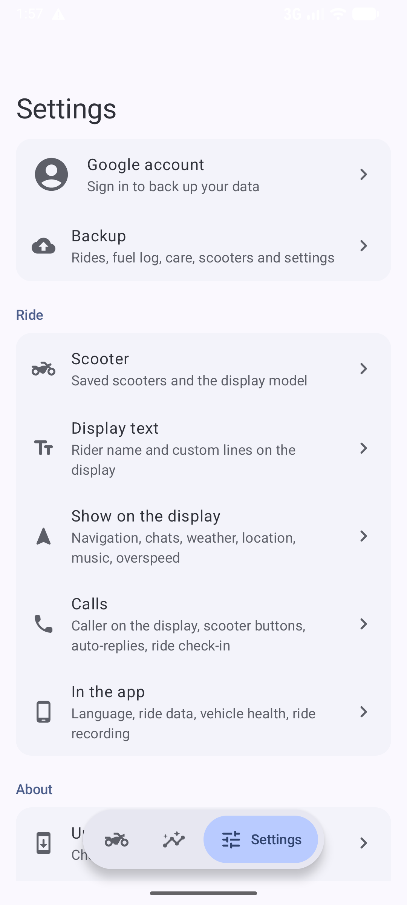 | 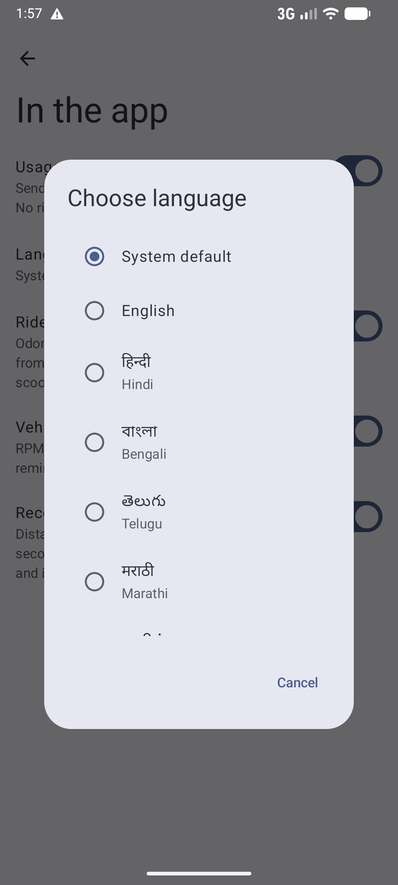 | 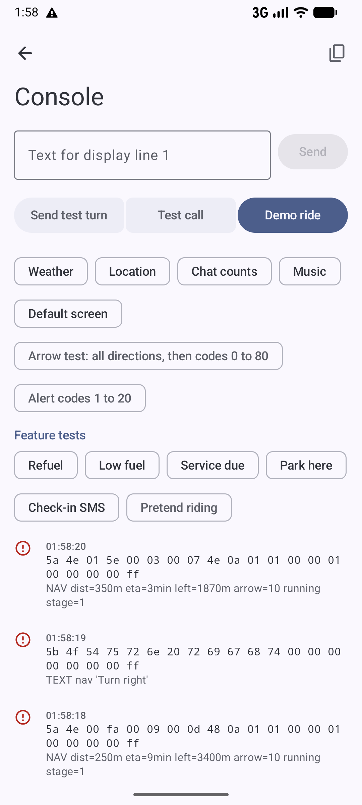 |
| Optional Google sign-in or skip for local-only | Firestore backup for rides, care & scooters | Modular settings sections & account status | English + 22 Scheduled Indian Languages | Live BLE frame log & diagnostic test injection |

## How it works

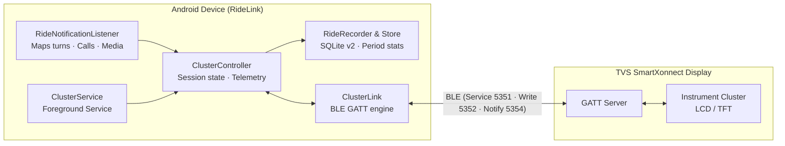

### Data flow

1. **Connection**: Scans for BLE advertisements matching TVS displays. Once paired, `ClusterService` maintains a persistent foreground GATT link with automatic reconnection.
2. **Handshake**: Negotiates MTU 512, enables notifications on `5354`, authenticates rider profile (`5B 52`), and syncs media state and social counts.
3. **Heartbeat & Telemetry**: Emits status packets (`5B 4A`) every 2 seconds with time, battery percentage, signal strength, network status, and ambient temperature. Incoming notify frames (`5A 10`, `5A 11`, `5A 19`) update local speed, trip distance, fuel, range, and diagnostic telemetry.
4. **Navigation**: Intercepts Google Maps active navigation steps, converts direction arrows and distance meters into cluster-native control codes (`5B 4F` text + `5A 4E` instruction), and streams them with synchronized timing.
5. **Calls**: Injects ringing caller frames (`5B 43`) every 500 ms; handles cluster switch presses to answer or reject calls through Android's `TelecomManager`.

Full protocol reverse-engineering notes and frame structures are documented in [`PROTOCOL.md`](PROTOCOL.md).

## Architecture

RideLink is organized into three clean Gradle modules:

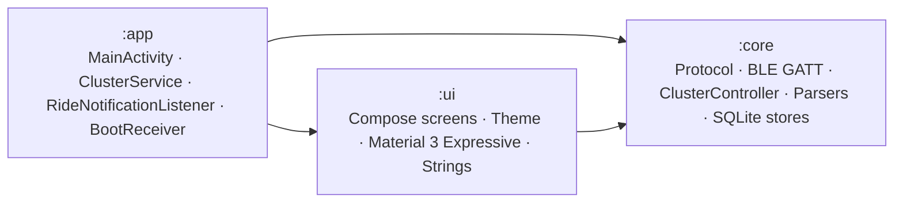

- **`:app`**: Application entry point, Android manifest, foreground services, broadcast receivers, and application lifecycle.
- **`:core`**: Protocol encoders/decoders, BLE GATT link manager, notification parsers, telecom integration, weather repository, SQLite databases (`garage.db`, `rides.db`, `care.db`), optional Google sign-in and the Firestore cloud backup (`core/backup`).
- **`:ui`**: 100% Jetpack Compose UI, Material 3 Expressive theming, navigation graphs, canvas analytics charts, and localized strings.

For deep dive into state ownership and lifecycle, see [`development/docs/ARCHITECTURE.md`](development/docs/ARCHITECTURE.md).

## Installation

### Releases

**[Download RideLink.apk](https://github.com/aiyu-ayaan/RideLink/releases/latest/download/RideLink.apk)** (latest stable, signed), open it on your phone and allow the install.
Older versions, Beta and Alpha builds are on the [Releases](https://github.com/aiyu-ayaan/RideLink/releases) page.

RideLink features an in-app updater (**Settings → About → Updates**). Once installed, updates can be checked, downloaded, and installed directly with support for **Stable**, **Beta**, and **Alpha** channels.

### Permissions explained

RideLink requests only the permissions needed to replicate dashboard functionality:

| Permission | Purpose |
|---|---|
| **Nearby devices / Bluetooth** | Connect to the scooter cluster over BLE. |
| **Notification access** | Read Google Maps navigation steps and incoming caller details. |
| **Phone state & call log** *(Optional)* | Display caller names and signal bar status on the speedometer. |
| **Answer phone calls** *(Optional)* | Accept incoming calls using the scooter's handlebar switch. |
| **Location (Coarse)** *(Optional)* | Fetch local weather and air quality via Open-Meteo for TFT clusters. |

## Development & build

### Prerequisites

- Android Studio Ladybug / Meerkat or newer
- JDK 17 or 21
- Android SDK 35 (Android 15)

### Build commands

```bash
# Clone the repository
git clone https://github.com/aiyu-ayaan/RideLink.git
cd RideLink

# Assemble debug APK
./gradlew assembleDebug

# Run unit tests
./gradlew test

# Run protocol verification tests
./gradlew :core:test --tests "com.aiyu.ridelink.core.protocol.*"
```

The debug APK will be placed at `app/build/outputs/apk/debug/app-debug.apk`.

### Test tools (`tools/`)

The repository includes desktop Python test utilities (requires BlueZ on Linux, `python3-dbus`, and `python3-gi`):

- **`tools/fake_cluster.py`**: Emulates a TVS SmartXonnect scooter display over BlueZ GATT, printing decoded frames received from the phone.
- **`tools/central_test.py`**: Simulates the phone central and injects pinned test frames into a real or virtual display.

## Privacy & ethics

- **Usage statistics**: Builds with Firebase configured send anonymous usage statistics through Firebase Analytics (app opens, screens, sessions), without the advertising ID. RideLink logs no ride data, names, numbers or locations to it. Turn it off in **Settings → In the app → Usage statistics**.
- **Cloud backup is opt-in**: Nothing is backed up until you sign in with Google. The backup lives at `RideLink/{your uid}` in Firestore, readable only by your account (see [`firestore.rules`](firestore.rules)). It holds your rides (routes, speeds, places), fuel log, care records, scooters and settings, including the check-in contact number, birthday and last parked spot. *Delete cloud data* (Google account dialog or Settings → Backup) removes it from the server only; other phones on the same account stop backing up automatically until someone taps *Back up now*. After a restore, *Settings → Scooter → Re-pair* moves a scooter's history to its new Bluetooth address if it changed.
- **Personal use project**: RideLink is an independent project and is not affiliated with, endorsed by, or connected to TVS Motor Company. No proprietary TVS code or assets are distributed.

## Related docs

- [`docs/VEHICLE_SUPPORT.md`](docs/VEHICLE_SUPPORT.md) — Vehicle support plan, rider reports and how to add a model
- [`PROTOCOL.md`](PROTOCOL.md) — Specification of TVS SmartXonnect BLE frames and opcodes
- [`development/docs/ARCHITECTURE.md`](development/docs/ARCHITECTURE.md) — Subsystem architecture and data flow
- [`development/docs/DESIGN_SYSTEM.md`](development/docs/DESIGN_SYSTEM.md) — Visual styling, tokens, and motion curves
- [`development/brand/BRAND.md`](development/brand/BRAND.md) — Brand identity, geometry, and asset guidelines
- [`CHANGELOG.md`](CHANGELOG.md) — Version history and release notes

## License

RideLink is **source-available, not open source**. The code is public to read and audit; copying, modifying, redistributing
or building your own version needs written permission. You may install and use the official release APKs for personal use.
See [LICENSE](LICENSE) for the full terms.
