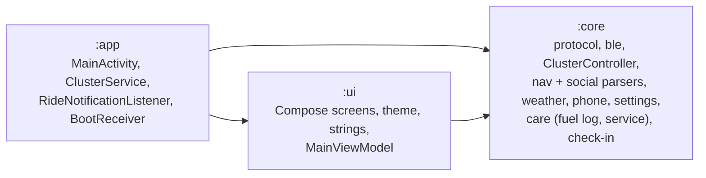
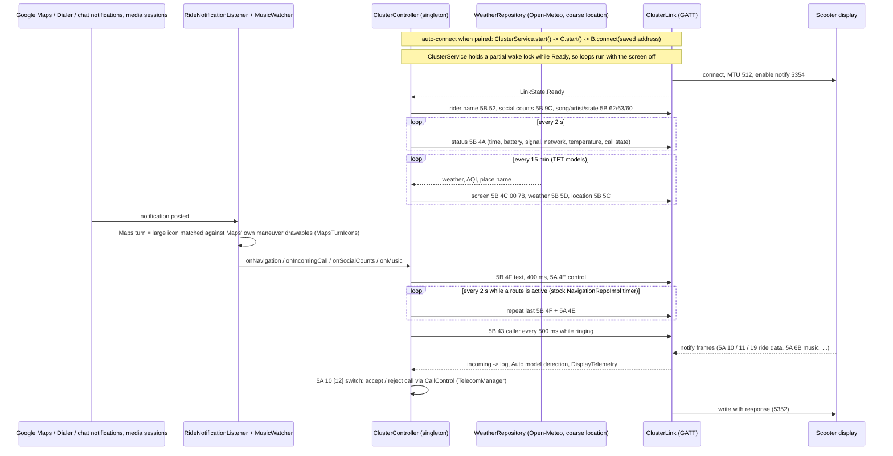
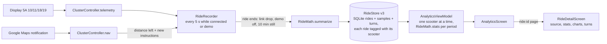
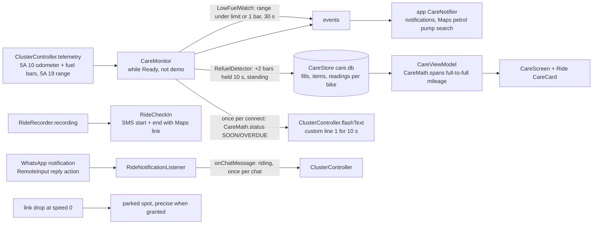
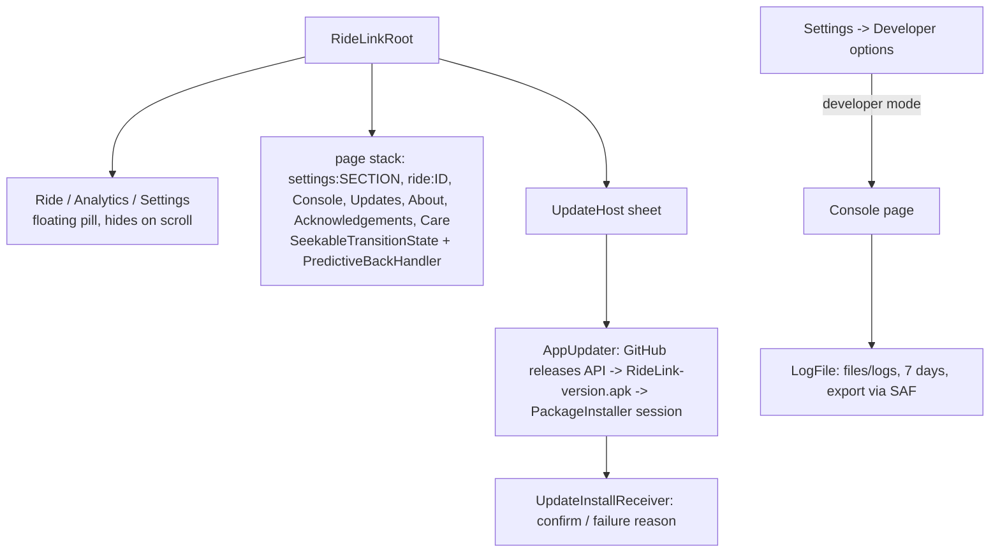

# Architecture

## Modules

## Ride data flow

## Ride analytics

`RideRecorder` is started from `RideLinkApp.onCreate` and lives for the process. Distance per interval:
Google Maps route progress (drop in distance-left) while navigating; the rest from the odometer (0.1 km) when it
agrees with integrated speed within 2x, otherwise integrated speed. The split is stored per ride (`maps_m`,
`odo_m`, `speed_m`).

## Fuel, service and safety

`ClusterService` runs as `connectedDevice|location` when location is granted (falls back to `connectedDevice`
when started from boot), so the parked spot and check-in link get a fix with the screen off.
Console -> Feature tests runs each of these paths without a scooter (Pretend riding enables WhatsApp replies).

## App shell and updates

## State ownership

| State | Owner | Exposed as |
|---|---|---|
| Active device, its model (null = Auto), rider name, toggles | `SettingsRepository` (DataStore) | `Flow<Settings>` |
| Every paired scooter with its own model | `GarageStore` (SQLite `garage.db`) | `StateFlow<List<Bike>>` |
| Connection | `ClusterLink` | `StateFlow<LinkState>` |
| Current nav step, caller, speed, telemetry, weather, place, music, social counts, detected model, frame log, demo | `ClusterController` | `StateFlow`s |
| Ride history (summaries + 5 s samples + Maps turns, per scooter) | `RideStore` (SQLite `rides.db`, v3) | `StateFlow<List<RideRecord>>` |
| Update check / download / install | `AppUpdater` | `StateFlow<UpdateState>` |
| Saved Console log | `LogFile` (`files/logs`) | export to a file the rider picks |
| Ride session lifetime | `ClusterService` (foreground, connectedDevice) | notification |

`ClusterLink` and `ClusterController` are Hilt singletons, so the service, the notification
listener and the UI all share one session.
