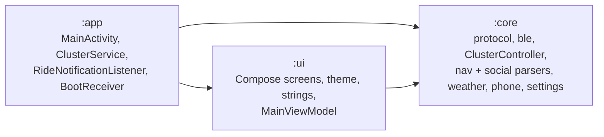
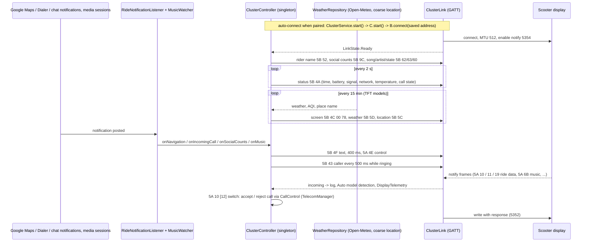
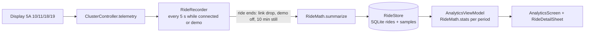

# Architecture

## Modules

## Ride data flow

## Ride analytics

`RideRecorder` is started from `RideLinkApp.onCreate` and lives for the process. Odometer distance (0.1 km)
is used when it agrees with integrated speed within 2x, otherwise integrated speed.

## State ownership

| State | Owner | Exposed as |
|---|---|---|
| Active device, its model (null = Auto), rider name, toggles | `SettingsRepository` (DataStore) | `Flow<Settings>` |
| Every paired scooter with its own model | `GarageStore` (SQLite `garage.db`) | `StateFlow<List<Bike>>` |
| Connection | `ClusterLink` | `StateFlow<LinkState>` |
| Current nav step, caller, speed, telemetry, weather, place, music, social counts, detected model, frame log, demo | `ClusterController` | `StateFlow`s |
| Ride history (summaries + 5 s samples) | `RideStore` (SQLite `rides.db`) | `StateFlow<List<RideRecord>>` |
| Ride session lifetime | `ClusterService` (foreground, connectedDevice) | notification |

`ClusterLink` and `ClusterController` are Hilt singletons, so the service, the notification
listener and the UI all share one session.
