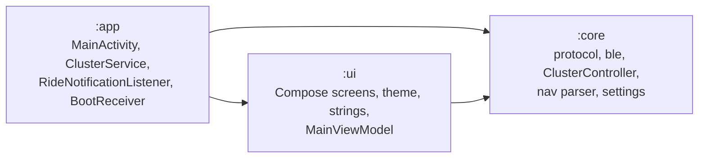
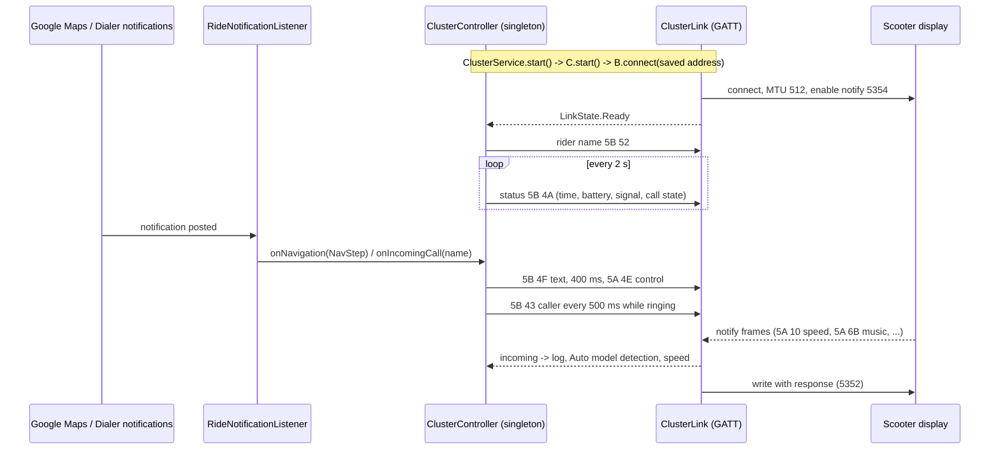

# Architecture

## Modules

## Ride data flow

## State ownership

| State | Owner | Exposed as |
|---|---|---|
| Saved device, model (null = Auto), rider name, toggles | `SettingsRepository` (DataStore) | `Flow<Settings>` |
| Connection | `ClusterLink` | `StateFlow<LinkState>` |
| Current nav step, caller, speed, detected model, frame log, demo | `ClusterController` | `StateFlow`s |
| Ride session lifetime | `ClusterService` (foreground, connectedDevice) | notification |

`ClusterLink` and `ClusterController` are Hilt singletons, so the service, the notification
listener and the UI all share one session.
